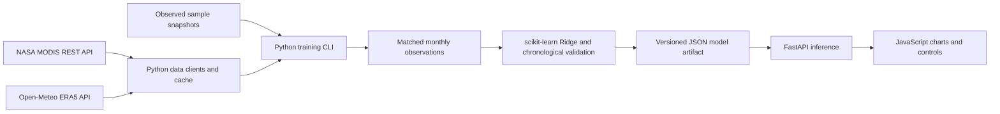

# Architecture

`geocast.pipeline` is the only application entry point that calls training. The API imports inference and artifact storage, so a chart request cannot trigger acquisition or fitting. `geocast.ml.forecast` accepts already fitted coefficients and produces the recursive trajectory and contributions. The browser receives a validated JSON response.

The static mount is restricted to `frontend/`, with API routes registered first. The backend never serves the repository root. Configuration defaults to paths relative to this checkout and can be overridden through `.env` or environment variables.

Each generated artifact contains its region, training timestamp, model/schema versions, NumPy/scikit-learn versions, a SHA-256 fingerprint of matched input rows, source metadata, observed history, six fitted equations, and validation results. Atomic replacement prevents readers from receiving a partly written file. Artifacts and public-data caches are ignored by Git and reproducible with the CLI.

The development server and model files are sufficient for this local MVP. A production deployment would additionally need authentication, rate limits, scheduled training/jobs, durable artifact storage, and operational monitoring. Those services are not implemented here.
